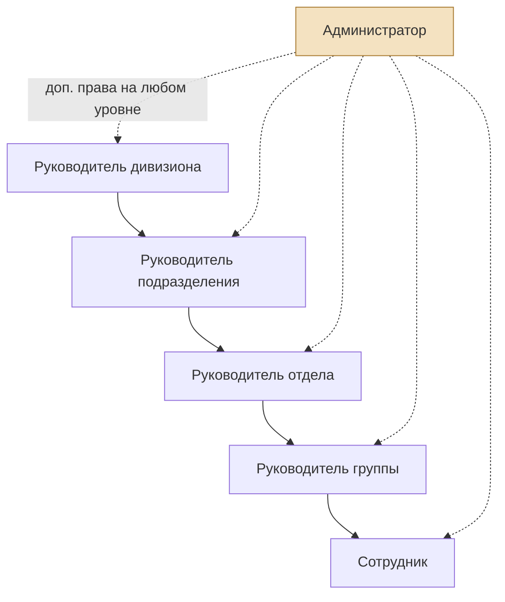
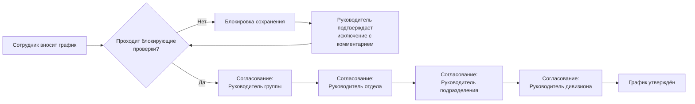

# Функциональное задание
## Приложение для сбора данных и подготовки графика отпусков

> Часть комплекта проектной документации. Обзор и порядок чтения — в `README.md`.

**Статус:** актуально
**Область:** документ описывает **целевое состояние системы** — полный набор требований независимо от того, в каком релизе они реализуются.

> Распределение требований по релизам зафиксировано отдельно в документе «Границы MVP и план релизов». Часть описанного здесь (согласование через 4 уровня, РВД и сверхурочные, почтовые уведомления, доменная авторизация, экспорт) вынесена за пределы первого релиза. Настоящий документ при этом не сокращается — он остаётся описанием целевой системы.

---

## 1. Общие сведения

### 1.1. Назначение системы
Веб-приложение предназначено для автоматизации процесса формирования, согласования и контроля графика отпусков сотрудников компании, с учётом норм трудового законодательства и внутренних правил компании, а также для учёта смежных типов отсутствия/переработки (внеплановое отсутствие, РВД, сверхурочная работа).

### 1.2. Платформа
Web-приложение. Мобильное приложение — за пределами текущих релизов, но архитектурно подготовлено (см. ADR-001).

### 1.3. Основные цели
- Обеспечить прозрачное планирование отпусков в разрезе оргструктуры.
- Автоматически контролировать соблюдение правил (нормы отпуска, длительность непрерывного отпуска, пересечения по тегам и т.д.).
- Дать руководителям инструмент согласования и контроля пересечений отпусков в критичных группах сотрудников (по тегам/компетенциям).
- Вести историю накопления и расходования отпускных дней.

---

## 2. Роли и права доступа

| Роль | Описание | Права |
|---|---|---|
| Сотрудник | Базовый пользователь | Вносит свой график отпуска и отметки отсутствия/РВД/сверхурочных; видит свой баланс дней; может назначать себе дополнительные теги |
| Руководитель группы | Первый уровень управления | Видит и редактирует графики всей структуры вниз (группа); согласует графики и правки |
| Руководитель отдела | Второй уровень управления | Видит и редактирует графики всей структуры вниз (отдел, включая группы); согласует графики и правки |
| Руководитель подразделения | Третий уровень управления | Видит и редактирует графики всей структуры вниз (подразделение) |
| Руководитель дивизиона | Четвёртый (верхний) уровень управления | Видит и редактирует графики всей структуры вниз (дивизион) |
| Администратор | Технико-организационная роль, может быть назначена дополнительно любому сотруднику независимо от основной роли (флаг доступа, не отдельная штатная единица) | Управление справочниками (праздники, теги, лимиты, нормы), загрузка списков сотрудников и графиков отпусков, финальное утверждение в случаях, когда штатной иерархии для согласования недостаточно |

Оргструктура — строгое дерево: у сотрудника один непосредственный руководитель на каждом уровне (группа → отдел → подразделение → дивизион).

---

## 3. Общая логика проверок (единый механизм)

Все проверки в системе реализованы по единому принципу: **это блокирующие проверки**.

- При нарушении правила система блокирует запись графика: она сохраняется черновиком с пометкой «ждёт подтверждения», руководителю уходит запрос, а отправить график на согласование нельзя, пока исключение не подтверждено *(решение от 25.10.2026: без сохранения руководителю нечего подтверждать)*.
- Разблокировка возможна только через подтверждение исключения соответствующим руководителем **с обязательным комментарием**.
- Черновик с неподтверждённым нарушением не занимает места в лимитах по тегам коллег.
- При превышении лимита по тегу сотруднику показываются коллеги с тем же тегом, уже находящиеся в отпуске в этот период, и их даты — чтобы договориться о переносе.
- Отдельных «информационных» алармов без блокировки в системе нет — единый механизм для всех правил.

Далее по каждому правилу указано, кто именно подтверждает исключение.

---

## 4. Функциональные блоки

### 4.1. Регистрация и авторизация

- **MVP:** регистрация пользователя внутри приложения (логин/пароль или email/пароль).
- **В перспективе:** авторизация через доменную учётную запись (SSO / AD / LDAP) — заложить архитектурную возможность подключения внешнего провайдера аутентификации без переработки модели пользователя.

### 4.2. Управление сотрудниками

#### 4.2.1. Загрузка списка сотрудников (CSV)
Массовая загрузка и обновление сотрудников файлом CSV. Доступно администратору.

**Формат CSV (предлагаемый):**

| Поле | Обязательное | Описание |
|---|---|---|
| employee_number | Да | Табельный номер — уникальный ключ записи |
| full_name | Да | ФИО |
| email | Да | Логин/email |
| hire_date | Да | Дата приёма на работу (для расчёта накопления отпуска) |
| group | Нет | Группа |
| department | Нет | Отдел |
| division_unit | Нет | Подразделение |
| division | Нет | Дивизион |
| manager_employee_number | Да | Табельный номер непосредственного руководителя |
| initial_balance_days | Нет | Начальный накопленный остаток отпуска на дату внедрения (для миграции действующих сотрудников) |
| extra_tags | Нет | Список дополнительных тегов через запятую (помимо автоматических тегов по оргструктуре) |

**Логика обновления:** при повторной загрузке файла запись с существующим `employee_number` обновляется (не дублируется); новый `employee_number` создаёт нового сотрудника.

*Примечание:* `employee_number` (табельный номер) — бизнес-ключ, используемый во всех файлах загрузки. Внутренний идентификатор записи в базе данных (`id`) в файлах не фигурирует.

При изменении оргструктуры (перевод сотрудника) — тег по оргструктуре пересчитывается автоматически, дополнительные (вручную назначенные) теги сохраняются без изменений.

#### 4.2.2. Назначение дополнительных тегов
Дополнительный (не связанный с оргструктурой) тег может назначить: руководитель любого уровня, администратор, а также сам сотрудник — себе.

### 4.3. Календарь праздников

- Компания работает в одном регионе — один производственный календарь.
- Загрузка на будущий год — через CSV, доступно администратору.

**Формат CSV (предлагаемый):**

| Поле | Обязательное | Описание |
|---|---|---|
| date | Да | Дата (ГГГГ-ММ-ДД) |
| name | Да | Название праздника |
| day_type | Да | Тип дня: `holiday` (праздничный нерабочий), `pre_holiday_short` (сокращённый предпраздничный), `transferred_workday` (перенесённый рабочий день) |

### 4.4. Настройка норм и накопления отпуска

- Норма отпускных дней в году (базово 28) — **настраиваемый глобальный параметр**, задаётся администратором.
- Накопление дней — **2.33 дня в месяц**, отсчёт с даты приёма на работу (`hire_date`).
- Округление дробных дней при расчёте баланса на произвольную дату — **математическое** (стандартное арифметическое округление).
- Ведётся полная история начислений и списаний дней (аудит).
- Для сотрудников, работавших в компании до внедрения системы — начальный остаток задаётся полем `initial_balance_days` при загрузке. Остаток действует на дату загрузки, начисление продолжается со следующего дня (подробно — `04-algorithms.md`, п. 1.6).

### 4.5. Расчёт баланса отпуска на дату

Система рассчитывает накопленный остаток отпускных дней на любую выбранную дату (прошлую, текущую или будущую — для планирования) на основе даты приёма на работу, нормы накопления и уже списанных/запланированных дней.

### 4.6. Внесение графика отпуска и проверки

#### 4.6.1. Базовые правила
| № | Правило | Тип проверки | Кто подтверждает исключение |
|---|---|---|---|
| 1 | Не менее 28 (настраиваемых) дней в году должно быть запланировано | Блокирующая | Непосредственный руководитель сотрудника |
| 2 | Не менее 14 дней — один непрерывный отпуск | Блокирующая | Непосредственный руководитель сотрудника |
| 3 | Отпуск более 14 дней подряд | Блокирующая (уведомление и подтверждение) | Непосредственный руководитель сотрудника |
| 4 | Отпуск, попадающий на праздничные дни, продлевается на количество праздничных дней | Автоматический расчёт с явным предложением сотруднику подтвердить сдвиг даты окончания | Сотрудник (подтверждает предложенный сдвиг) |
| 5 | Можно брать отпуск сверх 28 дней, если позволяют накопленные дни | Разрешено без ограничений, если хватает баланса | — |
| 6 | Превышение запрашиваемых дней отпуска над накопленным на расчётную дату остатком более чем на 7 дней | Блокирующая | Непосредственный руководитель сотрудника |
| 7 | Отпуск можно брать блоками Пт-Сб-Вс или Сб-Вс-Пн (с использованием выходных) | Разрешено без ограничений | — |
| 8 | Отпуск, целиком укладывающийся в рабочие дни недели без захвата хотя бы одного выходного дня | Блокирующая | Непосредственный руководитель сотрудника |

**Уточнение к правилам 7–8.** Правило 8 формулируется как общее: проверка срабатывает на любой период отпуска, который не захватывает ни одного выходного дня (суббота или воскресенье), а не только на конкретный блок «понедельник–пятница». Такая формулировка однозначно покрывает и промежуточные случаи (например, отпуск со вторника по четверг). *(Обобщение исходного требования — требует подтверждения на приёмке.)*

**Уточнение к правилу 1.** Норма «не менее 28 дней» проверяется в разрезе **календарного года**, к которому относится график. Проверка выполняется не при сохранении отдельной записи, а при отправке годового графика на согласование — поскольку до завершения планирования сумма запланированных дней заведомо меньше нормы.

#### 4.6.2. Виды отметок в графике
Помимо отпуска, в графике можно фиксировать:

1. **Внеплановое отсутствие** — фиксация факта отсутствия постфактум с указанием причины: выбор из справочника причин (больничный, отгул за свой счёт и т.п.) с возможностью выбрать «Другое» и указать причину в свободном текстовом поле. Учитывается **отдельным счётчиком** (количество дней внепланового отсутствия за период, в разрезе причин), не влияет на баланс отпускных дней. Счётчик доступен для просмотра сотруднику по себе, руководителям — по своей структуре, администратору — по всем.
2. **РВД (работа в выходной день)** — фиксация с обязательной ссылкой на задачу (текстовое поле URL). Функция учёта компенсации (отгул/оплата) реализуется как **опциональная** настройка, действующая на трёх уровнях с приоритетом «частное важнее общего»: глобальная настройка системы → переопределение на уровне оргединицы → переопределение на уровне конкретного сотрудника. Если переопределение не задано, действует значение вышестоящего уровня. При включённом учёте у записи РВД указывается вид компенсации: отгул или оплата.
3. **Сверхурочная работа** — фиксация с обязательной ссылкой на задачу (текстовое поле URL) и указанием количества часов переработки.

#### 4.6.3. Загрузка графика отпусков (CSV)

> **Статус: отложено в долгосрочный бэклог** (решение принято в сентябре 2026). Внесение графика выполняется только через интерфейс. Требование сохранено в документе как описание целевой системы, но в планируемые релизы не входит.

Массовая загрузка дат отпусков (и прочих отметок) через CSV — рассматривается как **обычный способ внесения графика**: при загрузке применяются все те же блокирующие проверки и требования к согласованию исключений, что и при ручном вводе.

**Формат CSV (единый, предлагаемый):**

| Поле | Обязательное | Описание |
|---|---|---|
| employee_number | Да | Табельный номер сотрудника |
| record_type | Да | Тип записи: `vacation`, `absence`, `rvd`, `overtime` |
| date_from | Да | Дата начала |
| date_to | Да (для vacation/absence) | Дата окончания |
| reason_code | Да (для absence) | Код причины из справочника причин отсутствия |
| custom_reason_text | Да, если `reason_code` = «Другое» | Текст причины в свободной форме |
| task_link | Да (для rvd/overtime) | Ссылка на задачу (URL) |
| hours | Да (для overtime) | Количество часов переработки |

*Примечание:* поля причины и ссылки на задачу разделены (а не объединены в одно универсальное поле), чтобы валидация при загрузке была однозначной и соответствовала структуре хранения данных.

### 4.7. Теги сотрудников и лимиты одновременного отсутствия

- Тег — самостоятельная сущность. Базово присваивается автоматически по оргструктуре (группа/отдел/подразделение/дивизион), может дополняться вручную (см. 4.2.2).
- В настройках ПО ведётся справочник тегов с указанием лимита — максимального числа сотрудников с данным тегом, которые могут одновременно находиться в отпуске.
- При превышении лимита по тегу — **блокировка сохранения графика и одновременно аларм руководителю** (оба механизма срабатывают вместе).
- Если у сотрудника несколько тегов — лимит проверяется **по каждому из тегов сотрудника** (пересечение проверяется по всем тегам одновременно).
- **Календарь по тегу:** доступен просмотр сводного графика отпусков всех сотрудников с выбранным тегом за период — для визуального выявления пересечений отпусков сотрудников со схожими компетенциями/функциями. Доступен руководителям (в пределах своей структуры) и администратору.
- В будущем предусмотрена интеграция с матрицей компетенций (отдельный проект/модуль) для автоматизированного назначения тегов на основе компетенций.

### 4.8. Согласование графика (workflow)

#### 4.8.1. Первичное согласование
Последовательное согласование по всем уровням иерархии снизу вверх:

`Сотрудник вносит график → Руководитель группы → Руководитель отдела → Руководитель подразделения → Руководитель дивизиона → График утверждён`

#### 4.8.2. Актуализация графика после утверждения
Обязательна поддержка внесения изменений в уже утверждённый график (без официального переутверждения документа, но с обязательным электронным согласованием):

- Любое изменение утверждённого графика должно быть согласовано **двумя уровнями руководства выше** сотрудника, чей график меняется.
- Если изменяется график **руководителя** — согласование проходит через уровни, стоящие выше **этого руководителя**.
- Если необходимых двух уровней иерархии выше не существует (сотрудник/руководитель находится близко к вершине структуры) — согласование проходит через все доступные уровни вплоть до дивизиона, а при их нехватке — финально утверждается администратором. *(Предположение, требует подтверждения на этапе приёмки.)*
- Все блокирующие проверки (раздел 4.6.1) продолжают действовать при внесении правок в утверждённый график.
- Ведётся журнал изменений: кто, когда, что изменил, кем согласовано.

### 4.9. Уведомления и алармы

Механизм доставки алармов, на которые ссылаются правила раздела 4.6.1 и лимиты по тегам (раздел 4.7):

- При срабатывании блокирующей проверки формируется уведомление руководителю, от которого требуется подтверждение исключения.
- При превышении лимита одновременного отсутствия по тегу — уведомление руководителю формируется одновременно с блокировкой.
- Уведомления формируются также при поступлении графика на согласование и при принятии/отклонении решения по нему.
- **Канал доставки в MVP:** внутренняя лента уведомлений в интерфейсе приложения (список «Требует моего решения»). Отправка по электронной почте — вынесена за рамки MVP, но модель уведомлений проектируется так, чтобы добавление почтового канала не требовало изменения бизнес-логики.

### 4.10. Экспорт графика
В MVP — заглушка функциональности экспорта в Excel/PDF (формат и шаблон уточняются на последующих этапах, вопрос не является приоритетным для MVP).

---

## 5. Диаграммы

### 5.1. Иерархия ролей и область видимости

*Каждый руководитель видит и редактирует графики всей структуры, находящейся ниже него. Иерархия строго древовидная.*

### 5.2. Workflow первичного согласования графика

### 5.3. Workflow актуализации утверждённого графика

---

## 6. Нефункциональные требования (базовые для MVP)

- Web-приложение, адаптивная вёрстка для десктопа (мобильная версия — не в MVP).
- Хранение полной истории изменений (аудит) по балансу отпусков и по графику.
- Ролевая модель доступа на уровне данных (видимость по оргструктуре).
- Возможность расширения аутентификации до SSO/AD без изменения модели данных пользователя.

---

## 7. Открытые вопросы / предположения, требующие подтверждения на этапе приёмки

1. Порядок согласования актуализации графика для сотрудников/руководителей, находящихся близко к вершине оргструктуры (см. п. 4.8.2) — принято предположение об эскалации к администратору.
2. Точный формат и шаблон экспорта (Excel/PDF) — вынесен за рамки MVP.
3. Точный состав справочника причин внепланового отсутствия — уточняется на этапе проектирования БД.
4. Обобщение правила 8 на любой отпуск без захвата выходных (см. уточнение к п. 4.6.1) — требует подтверждения, что это соответствует исходному намерению.
5. Индивидуальная норма отпуска: сейчас норма задана глобально. Если в компании есть категории сотрудников с увеличенной нормой (например, дополнительный отпуск за особые условия труда), потребуется индивидуальное переопределение нормы — в модели данных возможность заложена, но в MVP не используется.
6. Канал доставки уведомлений в MVP ограничен интерфейсом приложения; необходимость почтовых уведомлений требует подтверждения.
