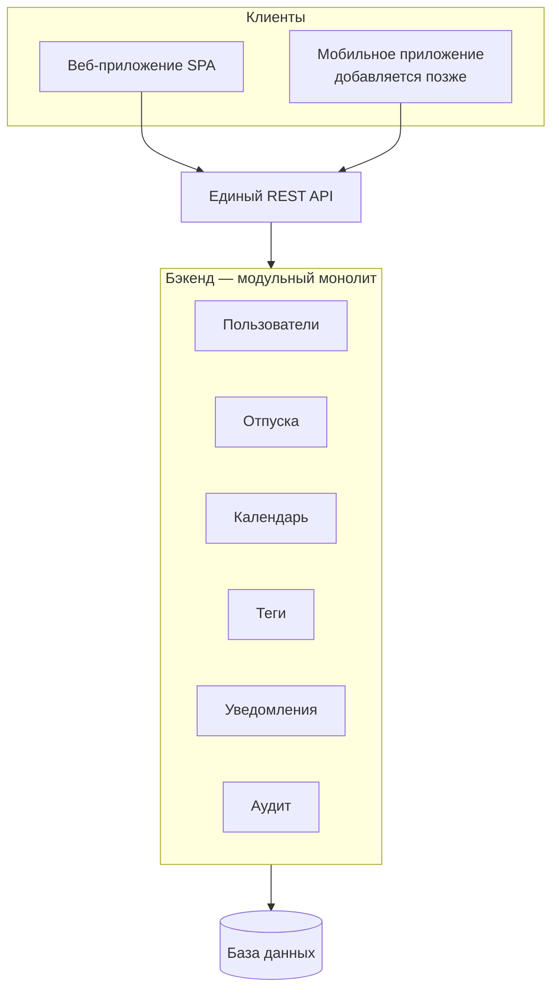

> Часть комплекта проектной документации. Обзор и порядок чтения — в `README.md`.

# ADR-001: Архитектурный подход к приложению графика отпусков

**Статус:** Принято

---

## 1. Контекст

Разрабатывается приложение для сбора данных и подготовки графика отпусков (см. функциональное задание). К архитектуре предъявлены следующие требования:

- лёгкость понимания и сопровождения (команда небольшая, опыт в вебе — ограниченный);
- экономность в вычислительных и инфраструктурных ресурсах;
- современный, но не избыточно сложный технологический подход;
- архитектурная готовность к появлению мобильного приложения в будущем без переработки серверной части.

## 2. Рассмотренные варианты

| Вариант | Суть | Почему не выбран |
|---|---|---|
| Классическое серверное приложение (SSR-монолит: Django/Rails/ASP.NET MVC-стиль) | Сервер сам собирает готовый HTML для браузера | Плохо готов к мобильному клиенту — придётся либо дублировать логику, либо позже пристраивать API поверх существующего кода |
| Гибридный SSR+SPA фреймворк (Next.js/Nuxt) | Первая страница рендерится на сервере, дальше работает как SPA | Решает задачи, которых у внутреннего корпоративного инструмента нет (SEO, публичная индексация); добавляет сложность без выгоды |
| Микросервисная архитектура | Каждая функция — отдельный сервис со своей базой | Существенный рост сложности разработки и эксплуатации (сетевое взаимодействие, распределённые транзакции, DevOps-нагрузка), неоправданный для команды и масштаба задачи |
| **SPA + единый REST API на модульном монолите** | Тонкий клиент в браузере обращается к одному серверному процессу с чётко разделёнными внутри модулями | **Выбран** — см. раздел 3 |

## 3. Принятое решение

Архитектура строится по принципу **API-first модульный монолит**:

1. **Клиент (веб)** — SPA (Single Page Application), обращается к серверу только за данными через REST API. Сервер не занимается версткой HTML.
2. **Клиент (мобильный, в будущем)** — отдельное приложение, использующее **тот же самый** REST API. Появление мобильного приложения не требует изменений на бэкенде.
3. **Бэкенд** — единый серверный процесс (один деплой, одна кодовая база), но код внутри разделён на независимые модули по границам предметной области:
   - Пользователи, оргструктура и роли
   - Отпуска, график и правила проверки
   - Календарь праздников и настройки
   - Теги и лимиты
   - Уведомления
   - Аудит
   - (в дальнейшем — интеграция с матрицей компетенций)
4. **База данных** — единая реляционная база данных, общая для всех модулей.

## 4. Обоснование

- **Понятность:** один проект, один язык программирования на бэкенде, один процесс развёртывания — весь путь запроса можно проследить без изучения сетевого взаимодействия между сервисами.
- **Экономность:** хостинг одного приложения и одной базы данных на порядок дешевле, чем инфраструктура из нескольких независимых сервисов (не нужны оркестрация, service mesh, отдельный мониторинг на каждый сервис).
- **Сопровождаемость:** модульное разделение внутри монолита даёт те же преимущества чистых границ, что и микросервисы, но без операционных издержек — при необходимости отдельный модуль можно будет вынести в будущем.
- **Современность:** это стандартный подход для бизнес-приложений среднего размера — обкатанный, с широкой поддержкой инструментов и документации.
- **Готовность к мобильному приложению:** поскольку бэкенд с первого дня отдаёт данные через API, а не готовую HTML-страницу, мобильное приложение в будущем становится просто ещё одним клиентом того же API.

## 5. Последствия и ограничения

- Модульные границы внутри монолита необходимо закладывать осознанно с самого начала (чёткое разделение кода по папкам/модулям, минимизация связности между ними) — иначе монолит рискует превратиться в трудноподдерживаемый "большой ком грязи".
- Если в будущем нагрузка или размер команды вырастут многократно, отдельные модули (наиболее вероятно — Отпуска или Уведомления) можно будет вынести в самостоятельные сервисы благодаря заранее выделенным границам.
- Архитектура закладывает возможность замены механизма аутентификации (с регистрации в MVP на доменную учётную запись/SSO) без изменения остальной части системы, при условии, что модуль "Пользователи" с самого начала инкапсулирует логику аутентификации отдельно от остальной бизнес-логики.

## 6. Вне рамок этого решения (следующие шаги)

- Выбор конкретного технологического стека (язык и фреймворк бэкенда, фреймворк для SPA, конкретная СУБД).
- Выбор варианта хостинга/размещения (облако, самостоятельный сервер, конкретный провайдер).
