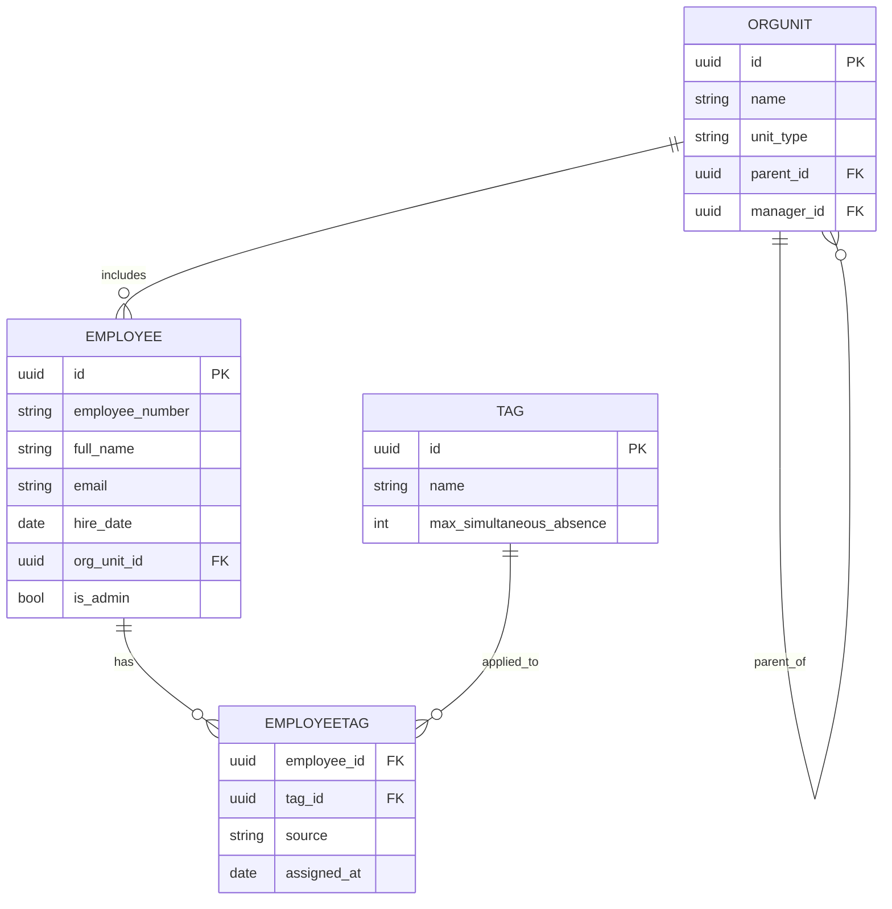
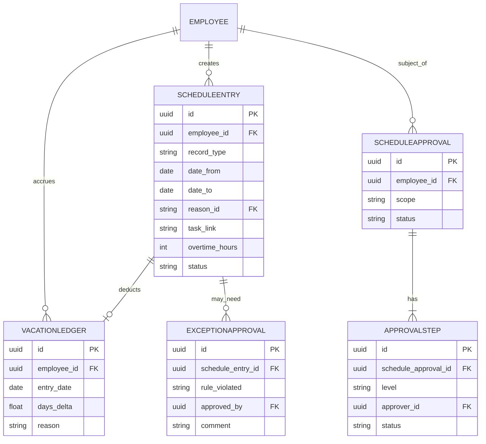

# Модель данных
## Приложение для сбора данных и подготовки графика отпусков

> Часть комплекта проектной документации. Обзор и порядок чтения — в `README.md`.

**Связано с:** ФЗ, ADR-001 (архитектура), ADR-002 (стек)

Сущности сгруппированы по модулям Django-приложений, заложенным в ADR-001.

---

## 1. Модуль «Сотрудники и оргструктура»

### Employee (Сотрудник)

| Поле | Тип | Описание |
|---|---|---|
| id | UUID (PK) | Идентификатор |
| employee_number | string, unique | Табельный номер — ключ при загрузке/обновлении из CSV |
| full_name | string | ФИО |
| email | string, unique | Логин |
| password_hash | string | Пароль (MVP-регистрация; в будущем — заменяется на доменную аутентификацию) |
| hire_date | date | Дата приёма на работу — точка отсчёта накопления отпуска |
| org_unit_id | FK → OrgUnit | Оргединица сотрудника (обычно нижний уровень — группа) |
| is_admin | bool | Флаг административных прав (может быть выставлен любому сотруднику) |
| status | enum (`active`, `inactive`) | Статус сотрудника (уволенные не удаляются — сохраняется история и аудит) |
| termination_date | date, nullable | Дата увольнения |
| annual_vacation_norm_override | decimal, nullable | Индивидуальная норма отпуска (null = действует глобальная из `CompanySettings`) |
| rvd_compensation_tracking_override | bool, nullable | Индивидуальное переопределение учёта компенсации РВД (null = наследуется от оргединицы/системы) |
| created_at / updated_at | datetime | Служебные |

*Замечание:* прямой руководитель сотрудника **не дублируется** отдельным полем — он однозначно определяется через `org_unit_id → OrgUnit.manager_id`. Единственный источник истины исключает рассинхронизацию при изменении оргструктуры.

### OrgUnit (Оргединица)

Единая таблица для всех уровней иерархии — группа, отдел, подразделение, дивизион. Дерево строится через `parent_id`.

| Поле | Тип | Описание |
|---|---|---|
| id | UUID (PK) | Идентификатор |
| name | string | Название оргединицы |
| unit_type | enum (`group`, `department`, `division_unit`, `division`) | Уровень иерархии |
| parent_id | FK → OrgUnit, nullable | Родительская оргединица (null только для верхнего уровня — дивизиона) |
| manager_id | FK → Employee, nullable | Руководитель данной оргединицы |
| rvd_compensation_tracking_override | bool, nullable | Переопределение учёта компенсации РВД для этой оргединицы (null = наследуется от системы) |

### Tag (Тег)

| Поле | Тип | Описание |
|---|---|---|
| id | UUID (PK) | Идентификатор |
| name | string, unique | Название тега |
| max_simultaneous_absence | int, nullable | Лимит сотрудников с этим тегом, которые могут одновременно быть в отпуске (null = без лимита) |

### EmployeeTag (Связь сотрудник–тег)

| Поле | Тип | Описание |
|---|---|---|
| employee_id | FK → Employee | |
| tag_id | FK → Tag | |
| source | enum (`auto_org`, `manual`) | Присвоен автоматически по оргструктуре или вручную |
| assigned_by_id | FK → Employee, nullable | Кто назначил (null для автоматических) |
| assigned_at | datetime | Дата назначения |

Составной первичный ключ: (`employee_id`, `tag_id`).

---

## 2. Модуль «Календарь и настройки»

### Holiday (Праздник)

| Поле | Тип | Описание |
|---|---|---|
| id | UUID (PK) | Идентификатор |
| date | date, unique | Дата |
| name | string | Название праздника |
| day_type | enum (`holiday`, `pre_holiday_short`, `transferred_workday`) | Тип дня |

### AbsenceReason (Справочник причин отсутствия)

| Поле | Тип | Описание |
|---|---|---|
| id | UUID (PK) | Идентификатор |
| name | string, unique | Название причины (больничный, отгул за свой счёт и т.п.) |
| is_other | bool | Признак служебной записи «Другое» — при выборе требует заполнения `ScheduleEntry.custom_reason_text` |

### CompanySettings (Настройки компании)

Единственная строка глобальных параметров (singleton).

| Поле | Тип | Описание |
|---|---|---|
| id | UUID (PK) | Идентификатор (всегда одна запись) |
| annual_vacation_norm_days | decimal | Норма отпуска в году (28, настраиваемая) |
| monthly_accrual_rate | decimal | Ставка накопления в месяц (2.33) |
| balance_overrun_alert_threshold_days | int | Порог превышения баланса, при котором требуется подтверждение руководителя (7) |
| rvd_compensation_tracking_enabled | bool | Включён ли глобально учёт компенсации РВД (опциональная фича) |
| organization_name | string | Название организации |
| brand_primary_color | string | Основной цвет бренда (HEX) |
| brand_contrast_color | string, nullable | Цвет текста на основном цвете (null = рассчитывается автоматически) |
| brand_radius | string | Радиус скругления элементов интерфейса |
| brand_font_family | string | Основная гарнитура |
| brand_logo | file, nullable | Логотип организации |
| brand_favicon | file, nullable | Иконка приложения |

---

## 3. Модуль «График, баланс и согласования»

### ScheduleEntry (Запись графика)

Универсальная запись для всех типов отметок.

| Поле | Тип | Описание |
|---|---|---|
| id | UUID (PK) | Идентификатор |
| employee_id | FK → Employee | Сотрудник |
| record_type | enum (`vacation`, `absence`, `rvd`, `overtime`) | Тип записи |
| date_from | date | Дата начала |
| date_to | date, nullable | Дата окончания (для `vacation`/`absence`; не используется для разовых `rvd`/`overtime`) |
| reason_id | FK → AbsenceReason, nullable | Причина (только для `absence`) |
| custom_reason_text | string, nullable | Текст при выборе причины «Другое» |
| task_link | URL, nullable | Ссылка на задачу (для `rvd`/`overtime`) |
| overtime_hours | decimal, nullable | Количество часов переработки (только для `overtime`) |
| rvd_compensation_type | enum (`day_off`, `payment`), nullable | Вид компенсации за работу в выходной день (только для `rvd`, при включённом учёте компенсации) |
| extended_by_holiday_days | int, default 0 | На сколько дней продлён отпуск из-за праздников, попавших в период |
| status | enum (`draft`, `pending_approval`, `approved`, `rejected`, `cancelled`) | Статус записи |
| rejection_comment | text | Причина отказа руководителя в исключении. Заполняется вместе со статусом `rejected`; сотрудник видит её у самого отпуска, а не только в ленте уведомлений |
| created_by_id | FK → Employee | Кто внёс запись (сотрудник или администратор при загрузке CSV) |
| created_at / updated_at | datetime | Служебные |

*Замечание:* обязательность полей зависит от `record_type` — контролируется на уровне логики приложения (валидация), а не ограничениями базы данных, чтобы не плодить отдельные таблицы под каждый тип.

### VacationLedger (Регистр баланса отпуска)

Построчная история начислений и списаний — основа для расчёта баланса на любую дату и для аудита.

| Поле | Тип | Описание |
|---|---|---|
| id | UUID (PK) | Идентификатор |
| employee_id | FK → Employee | Сотрудник |
| entry_date | date | Дата, на которую относится операция |
| days_delta | decimal(6,2) | Изменение баланса (+ начисление, − списание). Хранится без округления — округление применяется только при отображении и сравнении в правилах |
| reason | enum (`monthly_accrual`, `vacation_taken`, `manual_adjustment`, `initial_migration`, `termination_settlement`, `recalculation`) | Причина операции |
| related_schedule_entry_id | FK → ScheduleEntry, nullable | Связанная запись графика (для списаний по факту отпуска) |
| created_at | datetime | Служебное |

Баланс на дату = сумма `days_delta` по всем записям с `entry_date` ≤ выбранной дате.

### ExceptionApproval (Подтверждение исключения блокирующей проверки)

| Поле | Тип | Описание |
|---|---|---|
| id | UUID (PK) | Идентификатор |
| schedule_entry_id | FK → ScheduleEntry | Запись графика, вызвавшая блокировку |
| rule_code | FK → ValidationRule | Какое правило нарушено |
| approved_by_id | FK → Employee | Руководитель, подтвердивший исключение |
| comment | text | Обязательный комментарий |
| approved_at | datetime | Дата подтверждения |

### ValidationRule (Справочник правил проверки)

Правила вынесены в справочник, а не зашиты перечислением в коде — это позволяет включать/выключать правило и менять его пороговое значение без изменения программного кода и без миграции базы данных.

| Поле | Тип | Описание |
|---|---|---|
| code | string (PK) | Код правила (`min_annual_days`, `min_continuous_days`, `max_continuous_workdays`, `annual_ceiling`, `balance_overrun`, `no_weekend_captured`, `tag_limit_exceeded`) |
| name | string | Человеко-читаемое название |
| description | text | Формулировка правила для отображения в интерфейсе при блокировке |
| is_enabled | bool | Включено ли правило |
| threshold_value | decimal, nullable | Пороговое значение (28 / 14 / 7 и т.п.) |
| approver_level | enum (`direct_manager`, `employee`) | Кто подтверждает исключение |

### Notification (Уведомление)

| Поле | Тип | Описание |
|---|---|---|
| id | UUID (PK) | Идентификатор |
| recipient_id | FK → Employee | Получатель |
| notification_type | enum (`exception_required`, `tag_limit_alert`, `approval_required`, `approval_decided`) | Тип уведомления |
| related_entity_type | string | Тип связанной сущности |
| related_entity_id | UUID | Идентификатор связанной сущности |
| message | text | Текст уведомления |
| is_read | bool | Прочитано |
| created_at | datetime | Служебное |

*Канал доставки в MVP — лента в интерфейсе. Модель не содержит привязки к каналу, поэтому добавление почтовой рассылки не потребует изменения бизнес-логики.*

### ScheduleApproval (Согласование графика)

| Поле | Тип | Описание |
|---|---|---|
| id | UUID (PK) | Идентификатор |
| employee_id | FK → Employee | Чей график согласуется |
| scope | enum (`initial`, `amendment`) | Первичное утверждение или актуализация |
| status | enum (`pending`, `approved`, `rejected`) | Общий статус |
| created_at | datetime | Служебное |

### ApprovalStep (Шаг согласования)

| Поле | Тип | Описание |
|---|---|---|
| id | UUID (PK) | Идентификатор |
| schedule_approval_id | FK → ScheduleApproval | Родительское согласование |
| level | enum (`group`, `department`, `division_unit`, `division`, `admin`) | Уровень согласования |
| approver_id | FK → Employee | Согласующий |
| status | enum (`pending`, `approved`, `rejected`) | Статус шага |
| comment | text, nullable | Комментарий |
| decided_at | datetime, nullable | Дата решения |

---

## 4. Модуль «Аудит»

### AuditLog (Журнал изменений)

Общая таблица для истории изменений по всем ключевым сущностям (график, баланс, назначения тегов и т.п.).

| Поле | Тип | Описание |
|---|---|---|
| id | UUID (PK) | Идентификатор |
| entity_type | string | Тип изменённой сущности (`ScheduleEntry`, `EmployeeTag`, ...) |
| entity_id | UUID | Идентификатор изменённой записи |
| action | enum (`create`, `update`, `delete`) | Тип действия |
| changed_by_id | FK → Employee | Кто внёс изменение |
| changed_at | datetime | Когда |
| diff | JSON | Что именно изменилось (было/стало) |

---

## 5. Диаграммы

### 5.1. Сотрудники, оргструктура, теги

### 5.2. График, баланс, согласования

---

## 6. Принятые решения / допущения

1. Единая таблица `OrgUnit` для всех четырёх уровней иерархии вместо отдельных таблиц на каждый уровень — упрощает изменение структуры уровней в будущем.
2. Единая таблица `ScheduleEntry` для всех типов отметок графика (`record_type`) вместо отдельных таблиц под отпуск/отсутствие/РВД/сверхурочные — снижает дублирование; обязательность полей по типу контролируется в коде приложения.
3. `CompanySettings` — таблица-синглтон с одной строкой; при необходимости версионирования норм во времени (например, норма меняется для разных периодов) потребуется доработка до истории значений — вынесено за рамки MVP.
4. Расчёт баланса отпуска на дату — не хранится как отдельное поле, а вычисляется суммированием `VacationLedger` — исключает рассинхронизацию данных.
5. Прямой руководитель не дублируется полем в `Employee`, а выводится через `OrgUnit.manager_id` — единственный источник истины, исключающий рассинхронизацию при переводах сотрудников.
6. Правила проверок вынесены в справочник `ValidationRule` вместо жёсткого перечисления в коде — пороговые значения (28, 14, 7 дней) и признак включённости правила меняются администратором без правки кода и миграции базы. Это ключевой элемент готовности к изменению требований: подавляющее большинство вероятных изменений («сделать 30 дней вместо 28», «временно отключить проверку по выходным») превращаются из доработки в настройку.
7. Настройки, допускающие переопределение (учёт компенсации РВД, норма отпуска), реализованы по принципу наследования «система → оргединица → сотрудник» с приоритетом более частного уровня — позволяет вводить исключения для отдельных подразделений без изменения структуры данных.

---

## 7. Связанные документы

Алгоритмы вычислений над этими сущностями (накопление, длительность отпуска, продление на праздники, отпуск на стыке лет, увольнение, краевые случаи) вынесены в отдельный документ «Алгоритмы расчётов и краевые случаи».

## 8. Вне рамок этого документа

- Конкретные ограничения целостности на уровне БД (constraints, индексы) — прорабатываются на этапе реализации Django-моделей.
- Схема прав доступа на уровне API (какие поля/эндпоинты доступны какой роли) — отдельный документ.
